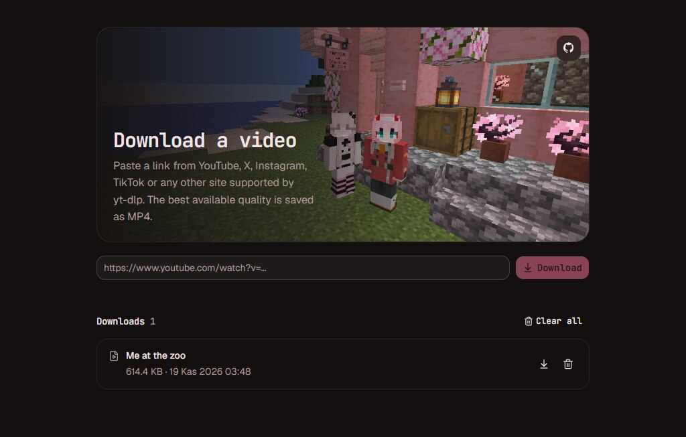

<a href="README.md">
  
</a>
<a href="README-TR.md">
  
</a>

  <br />
  <br />

<div align="center">
  
  <br />
  <br />

  <p>
     Videoları en iyi kalitede MP4 olarak indiren, kendi bilgisayarınızda çalışan bir araç.
  </p>


  <p>
    <a href="#about">Hakkında</a> •
    <a href="#features">Özellikler</a> •
    <a href="#tech">Teknolojiler</a> •
    <a href="#setup">Kurulum</a> •
    <a href="#license">Lisans</a>
  </p>

  <br />
  <br />
</div>



## <a id="about"></a> 📋 Hakkında

**Video Downloader**, kendi bilgisayarınızda çalışan bir web aracıdır. YouTube, X, Instagram, TikTok veya yt-dlp'nin desteklediği başka bir siteden bir bağlantı yapıştırın, video mevcut en iyi kalitede MP4 dosyası olarak kaydedilsin.

Backend, en iyi görüntü ve ses akışlarını ayrı ayrı indirip FFmpeg ile birleştirir. Böylece 1080p ve 4K gibi yüksek çözünürlükler, daha düşük kaliteli tek dosya biçimleriyle sınırlı kalmaz. yt-dlp ve FFmpeg, `npm install` ile birlikte kurulur, ayrıca bir şey kurmanız gerekmez. İndirilen videolar yerel bir klasörde tutulur ve sayfada listelenir. Buradan dosyaları tekrar kaydedebilir veya silebilirsiniz.

## <a id="features"></a> ✨ Özellikler

- **Geniş site desteği**: YouTube, X, Instagram, TikTok ve yt-dlp'nin desteklediği diğer pek çok siteden video indirin.
- **En iyi kalitede MP4**: En iyi görüntü ve ses, video başlığıyla adlandırılan tek bir MP4 dosyasında birleştirilir. Dosyanın her yerde oynatılabilmesi için aynı çözünürlükte H.264 tercih edilir.
- **Anlık ilerleme**: İndirmeyi tek bir ilerleme çubuğuyla takip edin ve istediğiniz an iptal edin. İptal ettiğinizde yarım kalan dosyalar silinir.
- **İndirilenler listesi**: Her indirmeyi başlığı, boyutu ve tarihiyle görün. Bir dosyayı tekrar kaydedin, silin veya onay verdikten sonra listenin tamamını temizleyin.
- **Her zaman güncel**: yt-dlp, backend her başladığında otomatik olarak güncellenir.

## <a id="tech"></a> 🛠️ Teknolojiler

`React` · `Vite` · `Tailwind CSS` · `shadcn/ui` · `Base UI` · `Lucide React` · `Node.js` · `Express` · `yt-dlp` · `FFmpeg`

## <a id="setup"></a> 🚀 Kurulum

### Gereksinimler

- **Node.js**

### Adım Adım Kurulum

1. **Depoyu klonlayın**

   ```bash
   git clone https://github.com/xkintaro/video-downloader.git
   cd video-downloader
   ```

2. **Bağımlılıkları yükleyin**

   ```bash
   cd backend
   npm install
   cd ../frontend
   npm install
   ```

   Windows'ta bunun yerine `install-dependencies.bat` dosyasını çalıştırabilirsiniz.

3. **Backend sunucusunu başlatın**

   ```bash
   cd backend
   node index.js
   ```

4. **Geliştirme sunucusunu başlatın**

   Yeni bir terminalde:

   ```bash
   cd frontend
   npm run dev
   ```

Uygulamayı şu adreste açın: [http://localhost:5065](http://localhost:5065).

### Kullanım

- Windows'ta iki sunucuyu konsol pencereleriyle başlatmak için `run.bat`, arka planda başlatmak için `run-video-downloader.vbs` dosyasını çalıştırın.
- İndirilen videolar `backend/downloads` klasörüne kaydedilir.

### Yapılandırma

Portlar ve indirme klasörü `.env` dosyalarından ayarlanır:

```env
# backend/.env
VITE_BACKEND_PORT=5066
VITE_DOWNLOADS_DIR=downloads
```

```env
# frontend/.env
VITE_FRONTEND_API_URL=http://localhost:5066
VITE_DOWNLOADS_DIR=downloads
VITE_FRONTEND_PORT=5065
```

Backend portunu değiştirirseniz `frontend/.env` dosyasındaki `VITE_FRONTEND_API_URL` değerini de güncelleyin.

## <a id="license"></a> 📄 Lisans

Bu proje MIT Lisansı altında lisanslanmıştır. Detaylar için [LICENSE](LICENSE) dosyasına bakabilirsiniz.

#

<p align="center">
  <sub>❤️ Developed by "Mustafa TAŞAL" (kintaro)</sub>
</p>
