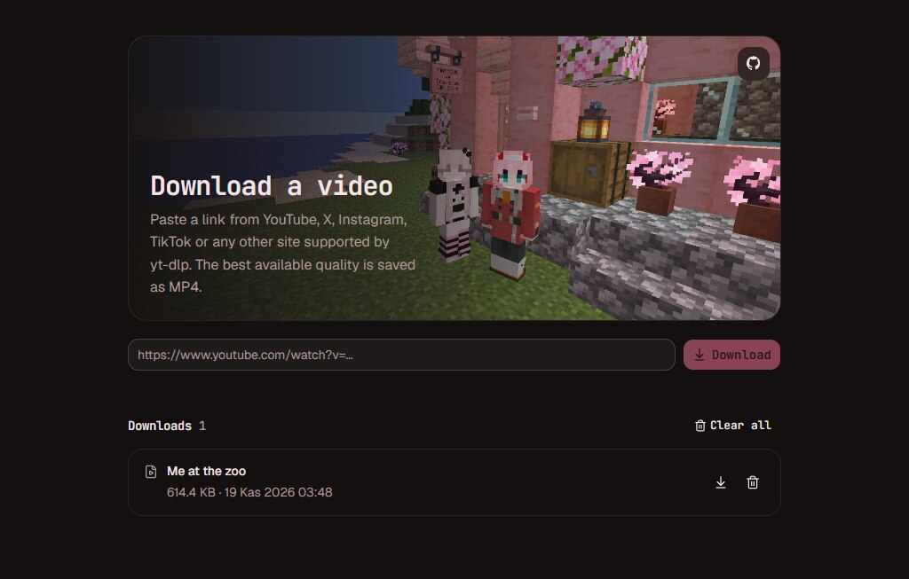

<a href="README.md">
  
</a>
<a href="README-TR.md">
  
</a>

  <br />
  <br />

<div align="center">
  
  <br />
  <br />

  <p>
     A self-hosted tool that downloads videos in the best quality as MP4.
  </p>


  <p>
    <a href="#about">About</a> •
    <a href="#features">Features</a> •
    <a href="#tech">Tech</a> •
    <a href="#setup">Setup</a> •
    <a href="#license">License</a>
  </p>

  <br />
  <br />
</div>



## <a id="about"></a> 📋 About

**Video Downloader** is a self-hosted web tool that runs on your own computer. Paste a link from YouTube, X, Instagram, TikTok or any other site supported by yt-dlp, and the video is saved in the best available quality as an MP4 file.

The backend downloads the best video and audio streams separately and merges them with FFmpeg, so high resolutions such as 1080p and 4K are not limited to the lower quality single-file formats. Both yt-dlp and FFmpeg are installed with `npm install`, so there is nothing else to set up. Downloads are kept in a local folder and listed on the page, where you can save them again or delete them.

## <a id="features"></a> ✨ Features

- **Wide site support**: Download from YouTube, X, Instagram, TikTok and the many other sites supported by yt-dlp.
- **Best quality as MP4**: The best video and audio are merged into a single MP4 file named after the video title. H.264 is preferred at the same resolution so the file plays everywhere.
- **Live progress**: Follow the download with a single progress bar and cancel it at any time. Partial files are removed when you cancel.
- **Downloads list**: See every download with its title, size and date. Save a file again, delete it or clear the whole list after a confirmation.
- **Always up to date**: yt-dlp is updated automatically every time the backend starts.

## <a id="tech"></a> 🛠️ Tech

`React` · `Vite` · `Tailwind CSS` · `shadcn/ui` · `Base UI` · `Lucide React` · `Node.js` · `Express` · `yt-dlp` · `FFmpeg`

## <a id="setup"></a> 🚀 Setup

### Requirements

- **Node.js**

### Step-by-Step Installation

1. **Clone the repository**

   ```bash
   git clone https://github.com/xkintaro/video-downloader.git
   cd video-downloader
   ```

2. **Install dependencies**

   ```bash
   cd backend
   npm install
   cd ../frontend
   npm install
   ```

   On Windows you can run `install-dependencies.bat` instead.

3. **Start the backend server**

   ```bash
   cd backend
   node index.js
   ```

4. **Start the development server**

   In a new terminal:

   ```bash
   cd frontend
   npm run dev
   ```

Open the app at [http://localhost:5065](http://localhost:5065).

### Usage

- On Windows, run `run.bat` to start both servers in console windows, or `run-video-downloader.vbs` to start them in the background.
- Downloaded videos are saved in the `backend/downloads` folder.

### Configuration

Ports and the downloads folder are set in the `.env` files:

```env
# backend/.env
VITE_BACKEND_PORT=5066
VITE_DOWNLOADS_DIR=downloads
```

```env
# frontend/.env
VITE_FRONTEND_API_URL=http://localhost:5066
VITE_DOWNLOADS_DIR=downloads
VITE_FRONTEND_PORT=5065
```

If you change the backend port, update `VITE_FRONTEND_API_URL` in `frontend/.env` as well.

## <a id="license"></a> 📄 License

This project is licensed under the MIT License. See the [LICENSE](LICENSE) file for details.

#

<p align="center">
  <sub>❤️ Developed by "Mustafa TAŞAL" (kintaro)</sub>
</p>
